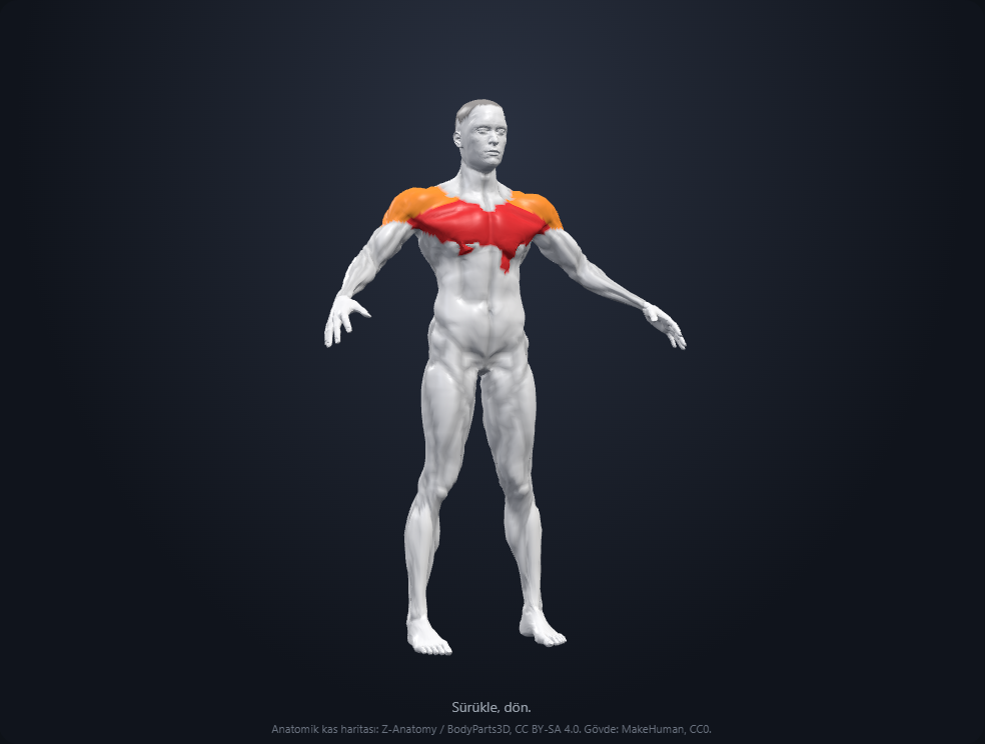
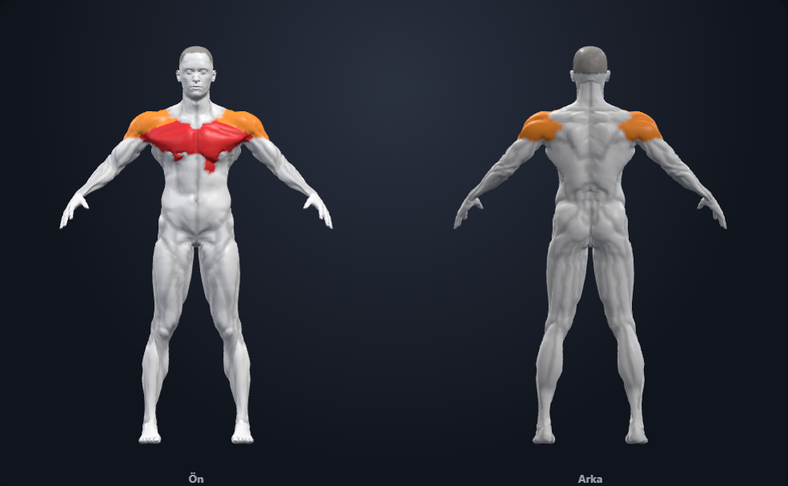

# ecorche-body

Parametric **human anatomy** for fitness apps. Pass **gender, height, weight, age** plus **primary / secondary** muscles. You get a rotatable 3D body and a front/back 2D sheet, with real muscle regions painted on a MakeHuman mesh.

<p>
  
</p>

```bash
npm install ecorche-body three
```

```jsx
import { Body3D, Body2D } from "ecorche-body";
import "ecorche-body/style.css";

<Body3D
  gender="male"
  height={175}
  weight={75}
  age={18}
  primary={["chest"]}
  secondary={["shoulders", "triceps"]}
  autoRotate
/>

<Body2D
  view="both"
  gender="female"
  height={165}
  weight={60}
  primary={["glutes"]}
  secondary={["hamstrings"]}
/>
```

<p>
  
</p>

## What it does

| Input | Effect |
| --- | --- |
| `gender` | Loads the male or female GLB (different skeleton, fat pads, muscle mass). |
| `height` | Uniform stature scale, in cm. |
| `weight` | BMI-based bulk: wider torso/limbs as BMI rises. |
| `age` | Softens surface (higher roughness). |
| `primary` | Vertex-painted **red** `#e83034` |
| `secondary` | Vertex-painted **orange** `#ff9230` |
| `pose` | `rest` · `curl` · `squat` (skinned skeleton) |

Models are ~4 MB each, ~54k vertices, with a `_MUSCLE` id per vertex. Highlighting is a color buffer update — no shader rewrite.

## Body3D props

| Prop | Type | Default | Notes |
| --- | --- | --- | --- |
| `gender` | `"male"` \| `"female"` | `"male"` | Which GLB to load |
| `height` | `number` | `178` / `165` | cm |
| `weight` | `number` | `78` / `62` | kg |
| `age` | `number` | `28` | years |
| `primary` | `string[]` | `[]` | Main working muscles |
| `secondary` | `string[]` | `[]` | Assistants |
| `primaryColor` | CSS color | `#e83034` | Override paint |
| `secondaryColor` | CSS color | `#ff9230` | Override paint |
| `autoRotate` | `boolean` | `true` | Yaw after a beat; stops on drag |
| `pose` | `"rest"` \| `"curl"` \| `"squat"` | `"rest"` | Demo joint bends |
| `modelUrl` | `string` | CDN GLB | Full URL to a `.glb` |
| `baseUrl` | `string` | jsDelivr | Directory that contains the two GLBs |
| `credit` | `boolean` | `true` | Attribution line (required by CC BY-SA) |
| `className` | `string` | `""` | Wrapper |

Drag horizontally to orbit, vertically for a little pitch.

## Body2D props

Same body/muscle/color/pose/url props as `Body3D`, plus:

| Prop | Type | Default | Notes |
| --- | --- | --- | --- |
| `view` | `"front"` \| `"back"` \| `"both"` | `"both"` | Locked orthographic cameras |

`view="both"` is one WebGL canvas, split Ön / Arka. Use that under an exercise clip.

## Muscle ids

Short fitness ids (what you pass in `primary` / `secondary`):

`neck` · `traps` · `shoulders` · `chest` · `biceps` · `triceps` · `forearms` · `abdominals` · `obliques` · `lats` · `middle back` · `lower back` · `glutes` · `abductors` · `adductors` · `quadriceps` · `hamstrings` · `calves`

Anatomical group names from the atlas also work: `Quadriceps`, `Pectoralis Major`, `Latissimus Dorsi`, `Gluteus Maximus`, …

```jsx
import { MUSCLE_IDS, GROUP_NAMES, ALIASES, latin } from "ecorche-body";

latin("chest");          // "PECTORALIS MAJOR"
ALIASES.chest;           // ["Pectoralis Major"]
GROUP_NAMES.includes("Biceps"); // true
```

## Self-host the models

By default the GLBs load from jsDelivr (`github:AygunAlpKagan/ecorche-body`). For production you can ship them yourself:

```bash
cp node_modules/ecorche-body/models/* public/ecorche/
```

```jsx
<Body3D gender="male" height={180} weight={82} baseUrl="/ecorche" primary={["quadriceps"]} />
```

Exports:

- `ecorche-body` — components
- `ecorche-body/style.css` — layout, canvas, captions
- `ecorche-body/models/*` — raw GLB + `muscles.json`

Peer dependency: **three >= 0.160**, React >= 18.

## Shape helper

```jsx
import { bodyShape } from "ecorche-body";

const shape = bodyShape({ gender: "female", height: 165, weight: 60, age: 24 });
// { bmi, bulk, definition, shoulder, chest, waist, hip, … }
```

## Credits

- Body mesh + skeleton weights: **MakeHuman (CC0)**
- Muscle id map (`_MUSCLE`, `muscles.json`): **Z-Anatomy / BodyParts3D (CC BY-SA 4.0)**

Please keep this line in the UI (the `credit` prop does it):

> Anatomik kas haritası: Z-Anatomy / BodyParts3D, CC BY-SA 4.0. Gövde: MakeHuman, CC0.

Code is MIT. Models are CC BY-SA 4.0. See [LICENSE.md](LICENSE.md).
